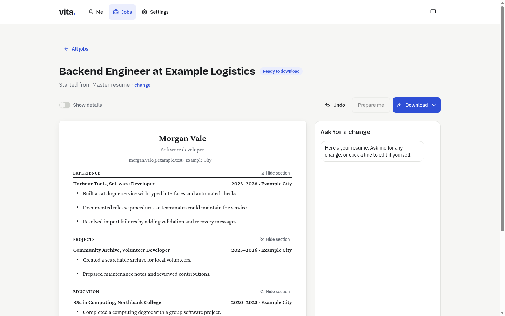
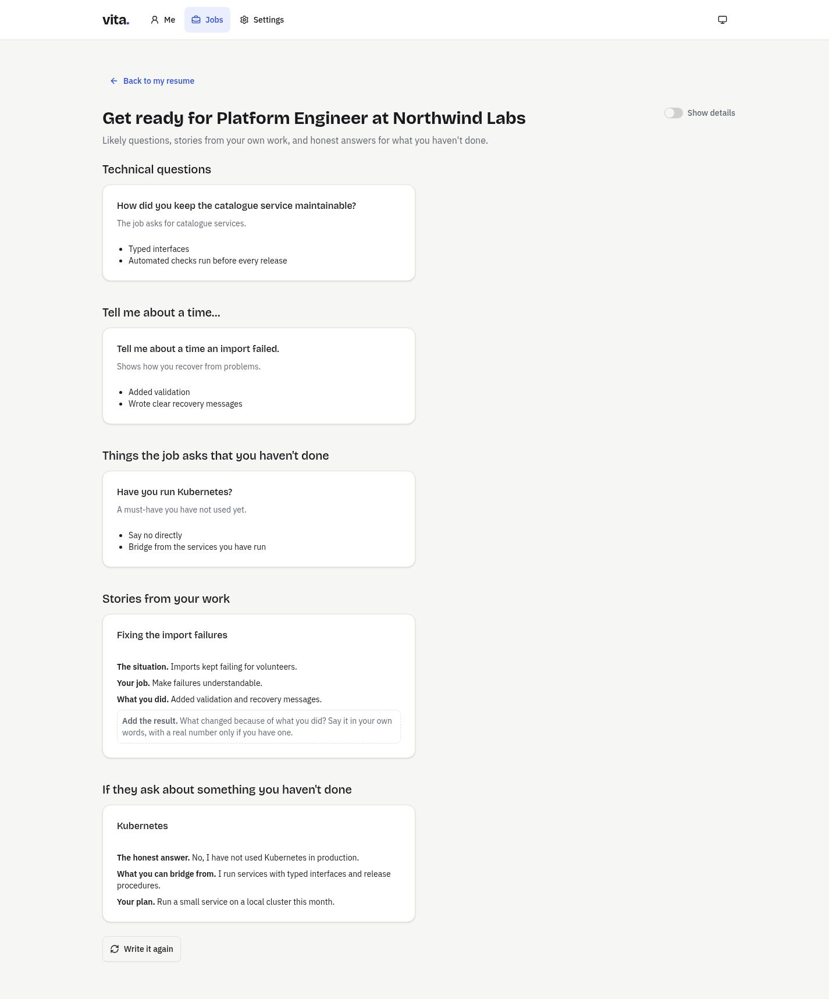
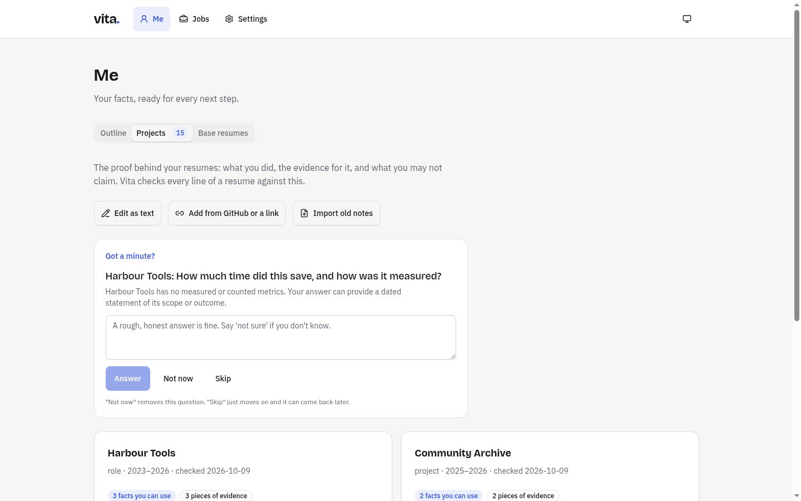
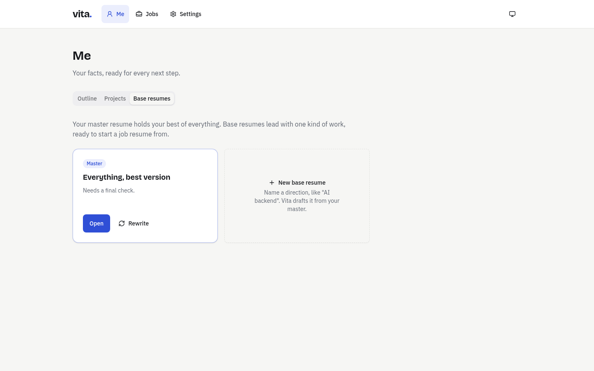
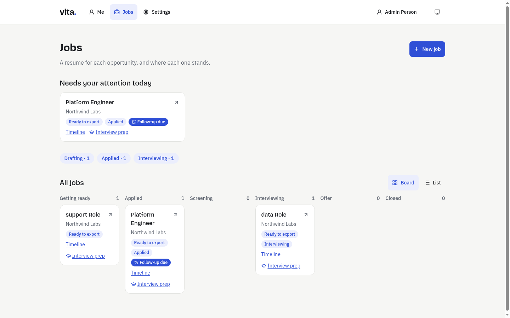
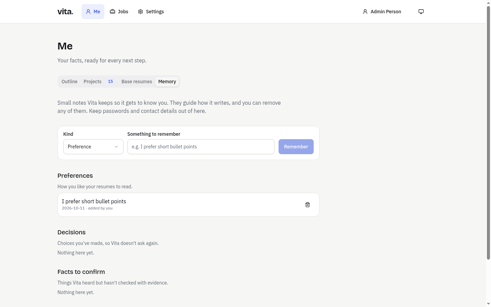
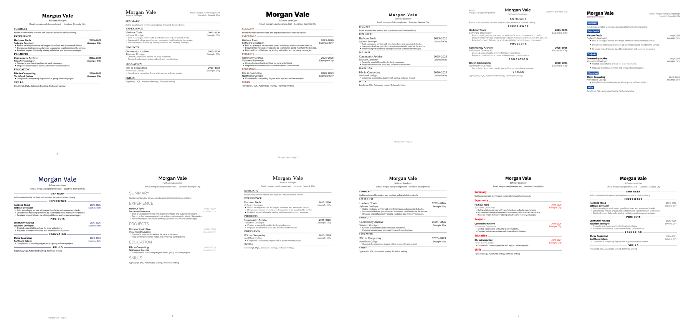
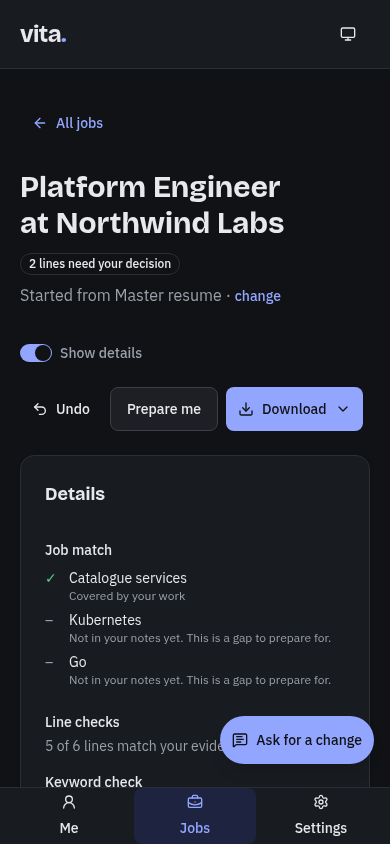

# Vita

A self-hosted resume studio. Paste a job, get a resume that is true to your work.

[](LICENSE)
[](.github/workflows/ci.yml)



Website and docs: **[vita.krishna.quest](https://vita.krishna.quest/)**

## What Vita is

Vita keeps one honest record of your work, then turns it into resumes. You write an outline in your own words and record the
evidence behind it. Vita generates a master resume, a base resume for each career direction you pursue, and a tailored resume for
each job you paste in. A separate model checks every line against your evidence before you see it, and nothing is exported until
the checks pass and you approve.

It is for people who apply to jobs and want tailored resumes without inventing anything, and who are comfortable running a Docker
container or a Node app on their own machine. Admins can add accounts with separate workspaces; Vita runs on infrastructure you control. The engine is
profession-neutral: it works for any career with the bundled `general` pack, and IT packs ship as data.

Your workspace is plain files (Markdown, YAML, JSON) in a git repository you own. Model access runs through the
Pi SDK, so you choose the providers, including subscription logins and local models.

## The core loop

**Paste a job, answer at most a few questions, review and edit a checked resume, download the PDF and Markdown.**

For someone with an existing profile, that takes about one to three minutes. Interview preparation follows from the same job.

## Features

Vita is organised around four layers: **outline → master → base → job**. Facts are written once and resumes are generated from
them.

### Getting started

- A first-run welcome offers three ways in: import an old resume (PDF, Word or text) and approve what Vita extracts, answer a
  short guided interview, or start from a starter outline with guidance for each section.
- Accounts with a login page: the first admin adds people, and every account has its own workspace.

### Outline and evidence

- Write freely in `outline.md`. Headings and bullets give it structure, and anything Vita cannot parse is preserved, never an error.
- Record projects, roles and certifications in `projects.md` as an evidence inventory: sources, claims, limits, and measured or
  counted outcomes.
- A metric interview asks for real numbers when a claim could use one, and stores your answers as dated evidence.
- A read-only research role scans public GitHub repositories out of the box and proposes evidence for your approval. Add your own token for private repositories; MCP is optional.

### Master and base resumes

- Generate a complete master resume, up to two pages.
- Create a base resume for each direction (for example DevOps or ICU nursing) with profession packs, emphasis, a template and a page budget.
- When your outline or evidence changes, Vita proposes updates to each resume as diffs. Locked bullets get suggestions, never edits.
- Promote a good edit upward, to the parent resume or into `projects.md`, always as a diff.

### Job resumes

- An analyst extracts must-have and nice-to-have requirements and suggests the closest base.
- Evidence selection is deterministic code (SQLite FTS5/BM25 over claims, variants and evidence), not a model.
- A writer drafts from selected claims. Every bullet cites claim IDs.
- Code lints the draft. A checker on a different model reviews each line. An ATS reviewer and the PDF check assess keyword
  coverage, extracted text, reading order and page count. Revisions are bounded to two rounds.
- Missing must-haves become plain-language questions. Answers are stored and reused.
- Edit any line directly or through chat. Your edits lock bullets, undo is a git revert, and fit to page tries layout knobs before
  proposing cuts.
- Export Markdown and a LaTeX-compiled PDF, then prepare for the interview: likely questions, stories from your own claims, and
  honest answers for gaps.
- Write a cover letter for the same job, with the same checks: every paragraph cites your claims, numbers need sources, and a
  separate checker reviews it before export.

### Tracking and memory

- An application tracker: a board of where each application stands, follow-ups with due dates, quiet applications flagged,
  interview events with the questions you were asked, contacts, outcomes, and the exact resume and letter versions you sent.
- Memory of your preferences, decisions and outcomes ("never mention project X for finance roles"), read by every assistant.
  Every entry is visible and deletable in Me → Memory, and nothing is remembered without your approval.
- "Yes" answers to gap questions can be saved to your evidence so the next job starts stronger.

### Templates, packs and rules

- Twelve Rover templates are bundled, with previews in a gallery, plus a matching cover-letter template. All use a deterministic
  LaTeX contract. Upload your own `.tex` or `.zip`, and Vita adapts it
  once in a sandbox and shows both PDFs for your approval.
- Profession packs (vocabulary, synonym groups, metric questions, section order) are data. `general` plus 13 IT packs are bundled.
- Rules (page limits, banned phrases, required sections, date format, locale) and layered standing instructions are files you edit.

## Honesty guarantees

Vita's [design principles](docs/specs/2026-10-09-vita-design.md#3-principles) are binding constraints.

- **Truth over polish.** No invented employers, skills, numbers or outcomes.
- **Every claim has a receipt.** Each resume line links to claims, and each claim links to evidence. An unsourced number blocks export.
- **Ask, don't guess.** Missing facts become questions, not assumptions.
- **The writer never grades itself.** A checker on a different model reviews every line. A rate-limit fallback never moves the
  checker onto the writer's model.
- **Rules live in code.** Unsourced numbers, missing claims, limit breaches and page overflow are code checks, not prompt requests.
- **Gaps are preparation, not lies.** Unmet requirements go to interview prep, never onto the resume.
- **Readable by people and machines.** Every PDF is compiled, text-extracted and order-checked.
- **Untrusted input stays data.** Job posts, web pages, repositories and uploads are never followed as instructions.
- **Your files, your models.** Plain files in git; deleting the app deletes nothing.

Honesty checks improve grounding. They do not replace your review of the facts.

## Screenshots

Fictional example data.

| Resume workspace | Interview prep |
| --- | --- |
|  |  |
| **Projects and the metric interview** | **Base resumes** |
|  |  |
| **Application tracker** | **Memory** |
|  |  |

The twelve bundled Rover templates:



On a phone, in dark mode, with details shown:



## Quick start: Docker

Follow the complete [self-hosting guide](docs/SELF_HOSTING.md) for Docker or native installs, subscriptions, API keys, local models, TLS and backups. Pi is bundled.

```sh
mkdir vita && cd vita
curl -fsSL https://raw.githubusercontent.com/krishna-vinci/vita/main/compose.yaml -o compose.yaml
curl -fsSL https://raw.githubusercontent.com/krishna-vinci/vita/main/.env.example -o .env
chmod 600 .env
docker compose up -d
docker compose logs vita
docker compose exec -it vita pnpm vita login  # type /login, then /quit
docker compose restart vita
docker compose exec vita pnpm vita models --available
docker compose exec vita pnpm vita doctor
```

Open **http://127.0.0.1:4317**, enter the logged setup code, and create the first admin. Choose available models in Settings with a different checker from the writer, then use the welcome import/interview flow to build your sources and generate a master resume. Writable `vita-home` and `pi-agent` mounts preserve accounts, workspaces and refreshed provider logins.

## Quick start: local development

Install Node.js 22, pnpm 10.28.2, git, Tectonic 0.17.0 and poppler (`pdftotext`, `pdfinfo`), then:

```sh
corepack enable
pnpm install --frozen-lockfile --prefer-offline
pnpm vita setup
pnpm vita login
export VITA_DATA_DIR="$PWD/vita-home"
pnpm vita doctor
pnpm server
# Another terminal:
pnpm web
```

Open **http://127.0.0.1:5173** for Vite development. For the built app, run `pnpm build:web` and open port 4317. The root `pnpm vita` command runs inside `cli/`; use absolute paths for workspace commands and `VITA_DATA_DIR` so the server and CLI share one database. Provider environment variables must be available to the server process; local startup does not automatically load `.env`.

## First run

1. Sign in (or create the first admin account), then set your name and contact details in `profile.yaml`. Models do not write the resume header.
2. Write freely in `outline.md`. Record sources, claims, limits and measured or counted outcomes in `projects.md`.
   If you have notes in an older format, `pnpm vita import` converts them (see the CLI reference).
3. Choose a default model and **distinct** writer and checker models in `config/models.yaml` or Settings. A new workspace uses one
   model for every role and warns until you pick a different checker.
4. Generate a master resume, create a base for each direction, then paste a job.

## How it works

1. Write freely in `outline.md`. Record sources, claims, limits and measured or counted outcomes in `projects.md`. `profile.yaml`
   supplies your name and contact details; models do not write the header.
2. Generate a master resume (up to two pages). Create bases from the master for career directions, with packs, emphasis, a template
   and page budget.
3. Paste a job. An analyst extracts requirements, code selects evidence, and a writer drafts from linked claims. Missing
   requirements are recorded as gaps.
4. Code flags unsourced numbers, missing claims, limit breaches, wording and layout problems. A different checker model reviews
   support; ATS and PDF checks assess coverage, extracted text and reading order. Revisions are bounded.
5. Review remaining questions, edit directly or through chat, and export when the checks pass. User edits lock bullets; source
   changes and layer synchronization are proposals for approval. Interview prep uses supported evidence and calls out gaps.

`vita check` checks source/schema/claim integrity; it does **not** replace the pipeline's independent checker or export gate.
`vita render` compiles an existing master/base and checks its PDF; job outputs are managed by the generation pipeline.

## Configuration

Configuration lives in the **workspace**, separately from the app checkout.

| File or setting | Purpose |
| --- | --- |
| `config/models.yaml` | `default: provider/model-id`, plus `roles` overrides. Choose different resolved models for `writer` and `checker`; the checker cannot fall back to the writer model. |
| Pi `~/.pi/agent/auth.json` or provider env keys | OAuth/subscription credentials or keys such as `ANTHROPIC_API_KEY` and `OPENAI_API_KEY`. Docker persists credentials in writable `./pi-agent:/pi-agent` with `PI_CODING_AGENT_DIR=/pi-agent`. |
| GitHub (Settings → Integrations) | Public repository research needs no configuration or `gh` CLI. Add a fine-grained token for selected private repositories with **Contents: read** and **Metadata: read**. Tokens are encrypted per user in `vita.db`; `GITHUB_TOKEN` is an optional server fallback for users without a saved token. |
| `config/mcp.json` | Optional advanced integration. Pi-format `mcpServers`; secrets through `${ENV}` or `!command`. Research permits explicitly read-only tools and allow-listed web URLs. Use least-privilege credentials. |
| `instructions.md` | Workspace guidance; optional frontmatter selects `roles` and research `sources.urls` / `sources.mcp`. Instance guidance uses `VITA_INSTANCE_DIR/instructions/*.md`; job notes and chat add narrower guidance. Core invariants and write policies remain enforced. |
| `config/rules.yaml` | Page budgets, bullet length, banned phrases, required sections, section order, date format and locale. |
| `packs/<id>/pack.yaml` | Profession vocabulary, keyword groups, metric questions and writing guidance; workspace packs override bundled IDs. `general` works across professions, with bundled IT packs available. |
| `templates/<id>/` | LaTeX template contract and bounded layout knobs; workspace templates take precedence over bundled templates. Twelve Rover resume templates and a Rover letter template are bundled. |
| `skills/<name>/SKILL.md` | Workspace role guidance overrides the bundled skill with the same name. |

Role overrides currently include `analyst`, `writer`, `checker`, `ats-reviewer`, `resume-editor`, `source-editor`, `researcher`,
`interviewer`, `template-adopter` and `onboarder`. Base generation uses the writer model with the `build-base` skill. Settings and the
effective-prompt API expose configuration and instruction warnings. See [architecture](docs/ARCHITECTURE.md) and
[contributing](CONTRIBUTING.md) for extension contracts.

Server variables: `VITA_DATA_DIR` (default `./vita-home` relative to process cwd), `VITA_HOST` (default `127.0.0.1`), `VITA_PORT` (4317), `VITA_TRUST_PROXY=1` for a trusted TLS proxy, optional `VITA_INSTANCE_DIR`, and `VITA_PUBLIC_ORIGIN` when a proxy rewrites `Host`. Optional `GITHUB_TOKEN` supplies a server-wide GitHub fallback. Accounts are required on every bind. `VITA_WORKSPACE` is a legacy migration override: if it contains `outline.md` during first setup, the first admin uses it in place. `VITA_PASSWORD_HASH` is no longer read. See [installation](docs/INSTALL.md) for password recovery and backups.

## CLI reference

Run commands as `pnpm vita <command>` from the checkout; paths resolve from `cli/`.

| Command | Purpose / options |
| --- | --- |
| `init <dir> [--name <name>]` | Initialize a workspace; refuses an existing outline. |
| `import <dir> --projects <legacy.md>` | Import evidence and preserve free prose. Optional `--outline`, `--name`, `--headline`, repeatable `--contact 'Label=value[=url]'`. Writes source files; back up an existing workspace first. |
| `login` | Run bundled Pi interactively; type `/login`, complete the provider flow, then `/quit`. |
| `models [--available]` | List Pi model IDs; mark credentials or filter to available models. |
| `doctor [dir]` | Check dependencies, cached rendering, credentials, and optional workspace role models; exits 1 on FAIL. |
| `setup` | Download TeX packages by compiling trusted bundled templates. Needed before offline renders. |
| `users` | List accounts and workspace paths in `VITA_DATA_DIR/vita.db`. |
| `reset-password <username>` | Read a new password from stdin and revoke all sessions. Set the same absolute `VITA_DATA_DIR` as the server. |
| `hash-password` | Legacy helper: print a scrypt hash from stdin; the server no longer accepts an environment hash. |
| `master <dir>` | Generate and check a master resume. Requires a named profile and configured provider access. |
| `tailor <dir> --job <file\|->` | Generate/check a job resume; optional `--base <id>` and `--slug <slug>`. `-` reads job text from stdin. |
| `render <dir> [--resume <id>] [--out <dir>]` | Compile a master/base (default `master`) to PDF, Markdown and TeX and check extracted text/pages. |
| `check <dir> [--resume <id>]` | Validate source schemas and linked claims for a master/base. |

Example: `pnpm vita tailor "$PWD/vita-data" --job "$PWD/job.md" --base my-direction`. Generation returns a nonzero status when the
final review is not done; read the reported questions and blockers.

## Architecture

A pnpm/TypeScript/ESM workspace with five packages: `shared` (Zod schemas), `core` (workspace IO and git, parsing, search, lint,
operations, rendering, packs, templates, Pi roles and pipelines; no HTTP), `server` (Hono API, auth, job runner, SSE), `web`
(React, Vite, Tailwind and TanStack Query) and `cli`. Only `core/src/agent/` imports Pi, and every role gets a fresh session with
scoped tools and write policies enforced in code. Bundled `skills/`, `packs/` and `templates/` are data.
See [docs/ARCHITECTURE.md](docs/ARCHITECTURE.md) and the [design spec](docs/specs/2026-10-09-vita-design.md).

## Project status

Vita is pre-release. The full loop works end to end with real models: onboarding, evidence and research, master, base and job
resumes, cover letters, editing, interview prep, the application tracker and memory, with accounts for several people on one
server. Generation is lean: compact role contexts, cached checker verdicts for unchanged lines and parallel review stages cut cost
by about half on a real job without weakening any check. CI runs package typechecks, full faux-provider test suites and real PDF
render tests; tagged releases build amd64/arm64 GHCR images with provenance and SBOMs. No stable release is promised yet.

**Next up:** backups from inside the app, careers beyond IT (more profession packs), and optional cheap classifier models for
routing.

## Contributing

Read [CONTRIBUTING.md](CONTRIBUTING.md) first. It covers the development workflow, scoped test policy, and how to add a
profession pack, a LaTeX template, a skill or standing instructions. The design principles are part of the product contract.
Fixtures must be fictional, and never commit credentials, real resumes or private evidence.

## Security

Vita is self-hosted with separate account workspaces. Keep the port on loopback, and use TLS, a VPN or an SSH tunnel for remote access. Model
providers receive the context a role needs, so local storage does not keep provider calls local. There is no telemetry. Report
vulnerabilities privately as described in [SECURITY.md](SECURITY.md).

## Licence and attribution

Vita code is **AGPL-3.0-only**; see [LICENSE](LICENSE). The bundled Rover Base template is adapted from
[subidit's Rover resume templates](https://github.com/subidit/rover-resume), remains **CC BY 4.0**, and credits the author and
modifications in [NOTICE](NOTICE) and its metadata. Preserve those notices when redistributing.
